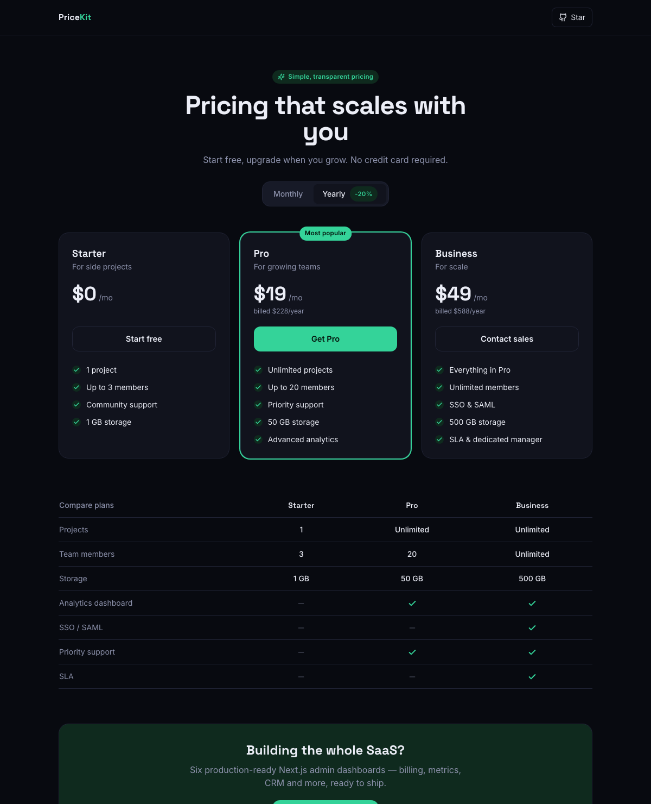

# Next.js Pricing Page Template — Free & Responsive

A clean, conversion-ready **pricing page / pricing table** for **Next.js 14 + Tailwind CSS**. Monthly/yearly toggle, three plans, a feature-comparison table and dark mode — all in one `page.tsx`. No UI library.




> ⭐ **Star the repo** if it saves you time.

## ✨ Features

- 💳 **Three pricing tiers** with a "Most popular" highlight
- 🔁 **Monthly / yearly toggle** with automatic −20% annual pricing
- 📊 **Feature comparison table** (check / dash / value cells)
- 🌙 **Dark mode** via CSS variables, no flash
- 📱 Fully responsive — cards stack, table scrolls on mobile
- 🧩 Plans are plain data — edit one array to change everything

## 🚀 Quick Start

```bash
git clone https://github.com/omer-poyraz/nextjs-pricing-page.git
cd nextjs-pricing-page && npm install && npm run dev
```

Edit the `PLANS` and `COMPARE` arrays in [`app/page.tsx`](app/page.tsx) — the whole page is driven by data.

---

## ⭐ Building the whole SaaS?

This pricing page pairs with a full set of **production-ready Next.js admin dashboards**:

### 👉 [**Admin Templates Bundle — 6 dashboards for $99**](https://omerpoyraz.gumroad.com/l/nextjs-admin-bundle)  ·  [free admin starter](https://github.com/omer-poyraz/nextjs-admin-dashboard-starter)

E-commerce · CRM · SaaS metrics · Blog/CMS · Project manager · Help desk.

---

## 📄 License

MIT © [Ömer Poyraz](https://omerpoyraz.gumroad.com). Free for personal and commercial use.

## 🔖 Keywords

`nextjs pricing page` · `pricing table` · `saas pricing` · `tailwind pricing` · `react pricing component` · `pricing section` · `nextjs saas` · `pricing cards`
